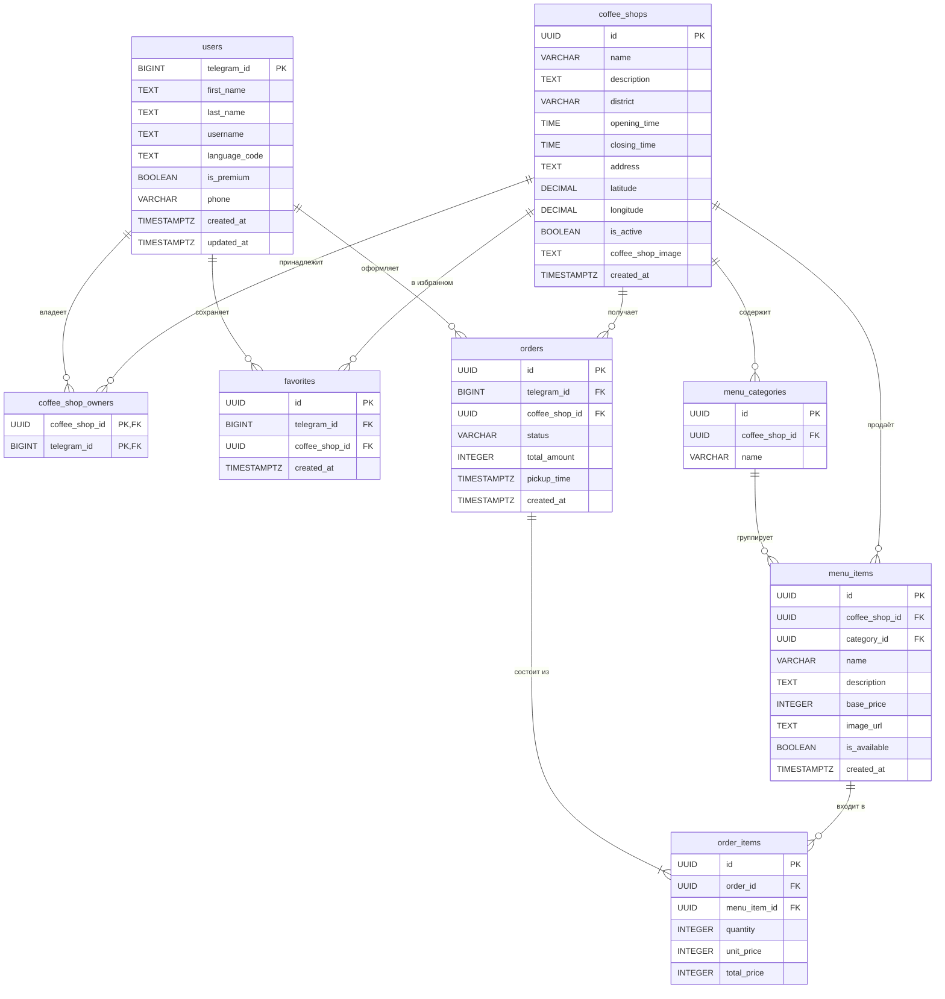

## База данных

Проект использует PostgreSQL 13+. Схема совпадает с ORM-моделями бэкенда
(`backend/db/models.py`); интеграционные тесты создают БД именно из `schema.sql`,
поэтому расхождение сразу видно в CI.

### ER-диаграмма



### Таблицы

| Таблица | Назначение |
|---|---|
| `users` | Пользователи Telegram. Запись создаётся или обновляется при входе через Mini App (`POST /api/v1/auth/telegram`), пароль не хранится |
| `coffee_shops` | Кофейни. `district` нужен для поиска по району (US-01), `is_active = false` скрывает кофейню из каталога |
| `coffee_shop_owners` | Владельцы кофеен, связь многие-ко-многим. У кофейни может быть несколько владельцев |
| `menu_categories` | Категории меню кофейни, название уникально внутри кофейни |
| `menu_items` | Позиции меню. `is_available = false` — «Нет в наличии» (US-03, US-04) |
| `orders` | Заказы. Корзина — это заказ в статусе `cart` |
| `order_items` | Позиции заказа с ценой на момент оформления |
| `favorites` | Избранные кофейни, пара пользователь–кофейня уникальна |

### Статусы заказа

| Статус | Значение |
|---|---|
| `cart` | Корзина, заказ ещё не оформлен |
| `pending` | Оформлен, ждёт подтверждения кофейни |
| `confirmed` | Кофейня приняла заказ и готовит |
| `ready` | Готов, можно забирать |
| `completed` | Выдан |
| `cancelled` | Отменён |

Допустимые переходы описаны в `docs/api.md` и проверяются в `backend/services/orders.py`.

### Ограничения

- первичные и внешние ключи; обязательные поля (`NOT NULL`);
- `UNIQUE`: категория внутри кофейни, запись в избранном, позиция меню внутри заказа;
- частичный уникальный индекс `uq_order_cart_per_shop`: не больше одной корзины у пользователя в каждой кофейне;
- `CHECK`: цены и суммы не меньше нуля, количество больше нуля, статус заказа из списка;
- `ON DELETE CASCADE`: меню, владельцы и избранное удаляются вместе с кофейней, позиции — вместе с заказом.
  Заказы и позиции заказов от каскада защищены: кофейню или позицию меню из оформленного
  заказа удалить нельзя, API предлагает скрыть их флагом.

### SQL-скрипты

- `database/schema.sql` — создание структуры с нуля.
- `database/seed.sql` — тестовые данные (2 кофейни, меню, заказы, избранное).
- `database/migration_merge.sql` — приведение уже существующей БД к этой схеме: владельцы
  переносятся из старого столбца `owners` в `coffee_shop_owners`, статус `new` становится
  `pending`, добавляются поля профиля Telegram, район и время получения заказа.
  Скрипт можно запускать повторно.

```bash
createdb caffein
psql -d caffein -f database/schema.sql
psql -d caffein -f database/seed.sql
```
